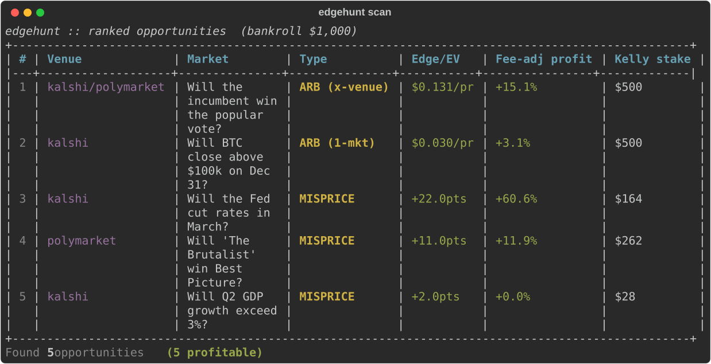
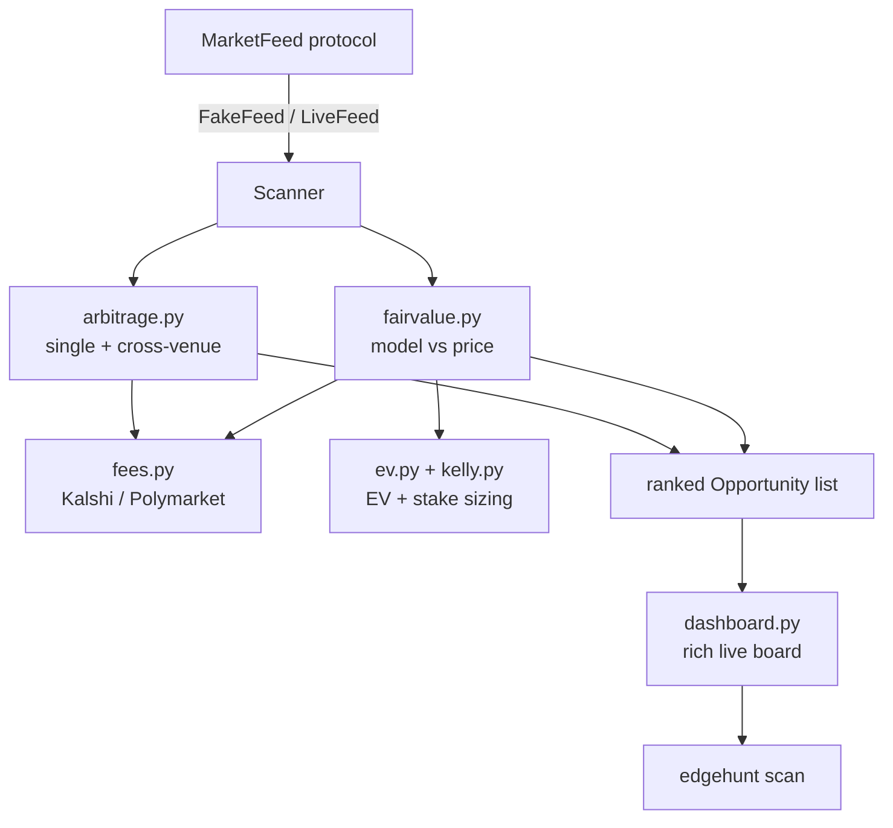

<div align="center">


# edgehunt

**Find the edge in prediction markets — cross-venue arbitrage, fee-adjusted EV, and Kelly sizing, in one command.**

_Built and maintained by **Viprasol Tech**._

[](https://github.com/Viprasol-Tech/edgehunt/actions/workflows/ci.yml)
[](LICENSE)
[](https://www.python.org/)
[](https://github.com/Viprasol-Tech/edgehunt)
[](https://t.me/viprasol_help)

</div>

---

`edgehunt` is an open-source **prediction-market edge & arbitrage engine**. Point it at Kalshi / Polymarket-style markets and it surfaces where the money is: **cross-venue arbitrage**, **fee-adjusted expected value**, **Kelly position sizing**, **break-even win-rate**, and **fair-value vs market mispricing** — all ranked on one colourful live terminal board.

It is an **analytics layer, not an execution wrapper**. `edgehunt` never places an order. It runs **fully offline with no API keys** thanks to a deterministic built-in feed, so you can `pip install -e .` and see a real opportunities table in 60 seconds.

## Live arbitrage dashboard

Run `edgehunt scan` and get a ranked, colour-coded board of every edge in the book (green = profitable). This is the real output, generated offline from the built-in feed:

<p align="center">
  
</p>

<details>
<summary>Plain-text version</summary>

```text
                            edgehunt :: ranked opportunities  (bankroll $1,000)
+----------------------------------------------------------------------------------------------------------+
| # | Venue             | Market                | Type          |   Edge/EV | Fee-adj profit | Kelly stake |
|---+-------------------+-----------------------+---------------+-----------+----------------+-------------|
| 1 | kalshi/polymarket | Will the incumbent    | ARB (x-venue) | $0.131/pr |         +15.1% |        $500 |
|   |                   | win the popular vote? |               |           |                |             |
| 2 | kalshi            | Will BTC close above  | ARB (1-mkt)   | $0.030/pr |          +3.1% |        $500 |
|   |                   | $100k on Dec 31?      |               |           |                |             |
| 3 | kalshi            | Will the Fed cut      | MISPRICE      |  +22.0pts |         +60.6% |        $164 |
|   |                   | rates in March?       |               |           |                |             |
| 4 | polymarket        | Will 'The Brutalist'  | MISPRICE      |  +11.0pts |         +11.9% |        $262 |
|   |                   | win Best Picture?     |               |           |                |             |
| 5 | kalshi            | Will Q2 GDP growth    | MISPRICE      |   +2.0pts |          +0.0% |         $28 |
|   |                   | exceed 3%?            |               |           |                |             |
+----------------------------------------------------------------------------------------------------------+
Found 5 opportunities  (5 profitable)
```

</details>

> Row 1 is a **risk-free cross-venue lock-in**: buy YES at 41c on Kalshi and NO at 43c on Polymarket — exactly one leg pays $1, so you net ~13c per pair after fees. Row 2 is a **single-market YES+NO < $1** arb. Rows 3–5 are **fair-value mispricings** ranked by expected value.

## 60-second Quickstart

```bash
git clone https://github.com/Viprasol-Tech/edgehunt.git
cd edgehunt
pip install -e .

edgehunt scan                       # the dashboard above, offline, no keys
edgehunt scan --bankroll 5000 --kelly-fraction 0.5 --min-edge 0.02
```

No network. No API keys. No account. The default feed is a deterministic set of realistic synthetic markets, so the demo and the entire test suite are reproducible everywhere.

## What it finds

- 🟢 **Cross-venue arbitrage** — same event, two venues; buy the cheap YES on one and the cheap NO on the other for a guaranteed, fee-adjusted lock-in.
- 🔒 **Single-market arbitrage** — `YES + NO < $1` after fees on a single venue is free money.
- 📈 **Fair-value mispricing** — feed your model probability; `edgehunt` picks the better side (YES/NO) by fee-adjusted EV.
- 💰 **Expected value** — clean `EV = p - price - fee` math for any position.
- 🎯 **Kelly sizing** — full, half, and fractional Kelly stakes from your bankroll, with a hard **no-bet-on-no-edge** rule.
- ⚖️ **Break-even win-rate** — the probability at which a position stops being worth it.
- 🧮 **Real fee models** — Kalshi's price-dependent per-contract fee and a Polymarket-style percentage fee, applied everywhere.

## Worked examples

```python
from edgehunt.ev import implied_probability, expected_value, break_even_probability
from edgehunt.fees import KalshiFeeModel
from edgehunt.models import Side

implied_probability(60)  # 0.60  -> the price IS the market's probability

# You think YES is 60% likely; it's on offer at 50c on Kalshi.
expected_value(0.60, 50, Side.YES, KalshiFeeModel())  # +0.08  ($0.08 edge per contract, after fees)
break_even_probability(50, Side.YES, KalshiFeeModel())  # 0.52   (need >52% to make money here)
```

```python
from edgehunt.kelly import kelly_fraction, stake

# 60% true probability on a 40c contract -> full Kelly is 1/3 of bankroll.
kelly_fraction(0.60, 40)  # 0.3333...
stake(bankroll=1000, win_probability=0.60, price_cents=40, fraction=0.5)  # $166.67 (half-Kelly)

# No edge? Stake is exactly zero — edgehunt never tells you to bet a losing line.
kelly_fraction(0.40, 50)  # 0.0
```

```python
from edgehunt.arbitrage import cross_venue_arbitrage
from edgehunt.models import Market

k = Market(
    venue="kalshi",
    ticker="K",
    question="Incumbent wins?",
    yes_bid=39,
    yes_ask=41,
    no_bid=58,
    no_ask=60,
    event_key="evt",
)
p = Market(
    venue="polymarket",
    ticker="P",
    question="Incumbent wins?",
    yes_bid=56,
    yes_ask=58,
    no_bid=41,
    no_ask=43,
    event_key="evt",
)

opp = cross_venue_arbitrage(k, p)
print(opp.description)  # Buy YES@41c on kalshi + NO@43c on polymarket locks $0.131/pair
print(opp.profit_per_dollar)  # ~0.151  (15.1% on deployed capital, risk-free)
```

## How the math works

**Implied probability.** A binary contract pays $1 if the event happens. So a price of 60c *is* the market's 60% estimate: `implied_probability(60) == 0.60`.

**Fee-adjusted expected value.** Buying YES at price `a` (as a fraction of $1) when the true probability is `p` pays `1 - a` on a win and costs `a` on a loss:

```
EV = p * (1 - a) - (1 - p) * a - fee
   = p - a - fee
```

The clean `p - price` form is why edge is so easy to reason about: your per-contract edge before fees is simply *your probability minus the price*.

**Kelly criterion.** For a binary contract priced at `a`, you risk `a` to win `1 - a`, so the net odds are `b = (1 - a) / a`. The growth-optimal stake fraction is:

```
f* = (p * b - (1 - p)) / b   =   p - (1 - p) / b
```

When `f*` is negative the bet has no edge and the correct stake is **zero**. Most practitioners use *fractional* (e.g. half) Kelly to cut variance — `edgehunt` defaults to half-Kelly.

**Fee models.** Kalshi charges `ceil(0.07 * count * p * (1 - p))` cents per fill — largest near 50c, tiny near the extremes. Polymarket-style venues take a flat percentage of notional. Both are applied to every EV and arbitrage calculation, so the numbers you see are net.

## Connect a live feed

`edgehunt` reads prices through a tiny `MarketFeed` protocol, so wiring a real venue is a thin adapter — nothing else changes:

```python
from edgehunt.feed import LiveFeed
from edgehunt.models import Market
from edgehunt.scanner import Scanner
import httpx


def kalshi_fetch() -> list[Market]:
    rows = httpx.get("https://api.elections.kalshi.com/trade-api/v2/markets").json()["markets"]
    return [
        Market(
            venue="kalshi",
            ticker=r["ticker"],
            question=r["title"],
            yes_bid=r["yes_bid"],
            yes_ask=r["yes_ask"],
            no_bid=r["no_bid"],
            no_ask=r["no_ask"],
            volume=r["volume"],
        )
        for r in rows
    ]


feed = LiveFeed(kalshi_fetch)  # add a fair_value_fn for mispricing signals
ranked = Scanner(feed, bankroll=5000).scan()
```

Implement `fetch_markets() -> list[Market]` for any venue (Kalshi, Polymarket, your own book) and the entire engine works against it. The library makes **no network calls on its own** — you control every request.

## Architecture



## CLI reference

| Command | What it does |
| --- | --- |
| `edgehunt scan` | Run the scanner over the feed and render the ranked board (`--bankroll`, `--kelly-fraction`, `--min-edge`). |
| `edgehunt ev P PRICE` | Expected value, implied probability and break-even for one contract. |
| `edgehunt kelly P PRICE` | Kelly fraction and dollar stake (`--bankroll`, `--kelly-fraction`, `--side`). |
| `edgehunt arb YES NO` | Single-market `YES + NO < $1` arbitrage check, fee-adjusted. |
| `edgehunt version` | Print the installed version. |

## Roadmap

- [x] Offline deterministic feed + colour terminal dashboard
- [x] Single-market & cross-venue arbitrage (fee-adjusted)
- [x] Fee-adjusted EV, break-even and Kelly sizing
- [x] Fair-value mispricing signals
- [ ] First-class Kalshi & Polymarket live adapters (opt-in extra)
- [ ] Liquidity / order-book depth weighting
- [ ] Multi-leg & correlated-event arbitrage
- [ ] JSON / CSV export and a watch mode

## FAQ

**Does it place trades?** No. `edgehunt` is pure analytics — it finds and ranks edges. You decide what to do with them.

**Do I need API keys to try it?** No. `edgehunt scan` runs entirely on a built-in deterministic feed with zero network access.

**Are the numbers real?** Yes. The EV, Kelly and arbitrage math is genuine and unit-tested against hand-computed values (85 tests), and the fee models follow each venue's published schedule.

**How do I use my own probabilities?** Provide a `fair_values()` mapping of ticker → probability on your feed; the scanner turns divergences from market price into ranked mispricing signals.

---

### ⭐ Star edgehunt if it helped you find an edge

> **Disclaimer:** `edgehunt` is provided for **educational and research purposes only**. It is not financial, investment, or trading advice. Prediction markets carry real risk of loss and may be restricted in your jurisdiction. Do your own research and never stake money you cannot afford to lose.

## Contact — Viprasol Tech Private Limited
- Website: [viprasol.com](https://viprasol.com)
- Email: [support@viprasol.com](mailto:support@viprasol.com)
- Telegram: [t.me/viprasol_help](https://t.me/viprasol_help) | WhatsApp: +91 96336 52112
- GitHub: [@Viprasol-Tech](https://github.com/Viprasol-Tech) | [LinkedIn](https://www.linkedin.com/in/viprasol/) | X [@viprasol](https://twitter.com/viprasol)

## License

[MIT](LICENSE) (c) 2025 Viprasol Tech Private Limited
